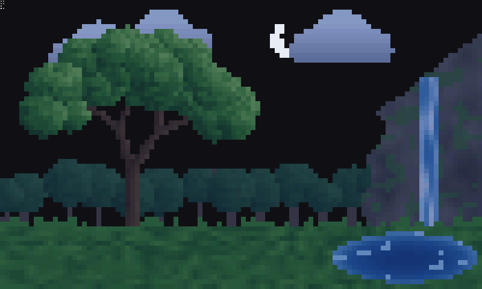
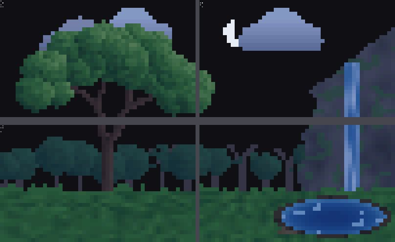
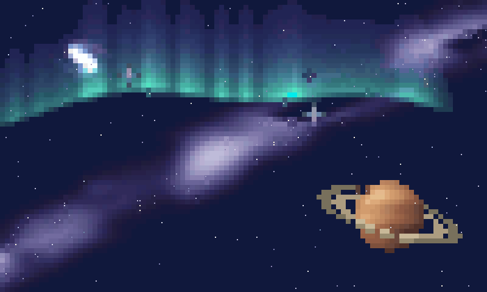
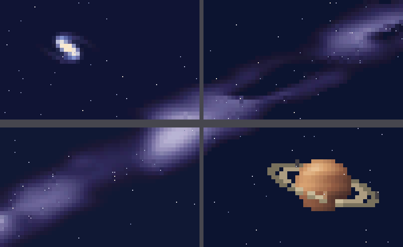

# tidetop

터미널에서 도는 tidepic 장면. [English](README.md)

tidetop 은 컴퓨터에 남은 여유를 숫자 대신 장면으로 보여 준다. 터미널 한쪽에 띄워 두고 곁눈으로 넉넉한지 빠듯한지를 읽는다.

| 컴퓨터 하나 | 창 넷을 이어 붙임 |
|---|---|
|  |  |

## 설치

tidetop 은 실행 파일 하나이고 따로 깔 것이 없다.

**한 번 띄워 보기** (Node.js 16 이상):

```bash
npx tidetop
```

**macOS**

```bash
brew install tidepark/tap/tidetop
```

**리눅스**

```bash
# 어느 배포판이든, curl 이나 wget 으로 (/usr/local/bin 또는 ~/.local/bin 에 깐다)
curl -fsSL https://raw.githubusercontent.com/tidepark/tidetop/main/install.sh | sh
wget -qO- https://raw.githubusercontent.com/tidepark/tidetop/main/install.sh | sh

# 데비안, 우분투
curl -fsSLO https://github.com/tidepark/tidetop/releases/latest/download/tidetop_linux_amd64.deb && sudo apt install ./tidetop_linux_amd64.deb

# 페도라, RHEL, 록키, 알마
sudo dnf install https://github.com/tidepark/tidetop/releases/latest/download/tidetop_linux_amd64.rpm

# 알파인
wget https://github.com/tidepark/tidetop/releases/latest/download/tidetop_linux_amd64.apk && sudo apk add --allow-untrusted ./tidetop_linux_amd64.apk
```

ARM(예: 라즈베리 파이, Graviton 서버)에서는 `amd64` 대신 `arm64`를 쓴다. `npm install -g tidetop`도 된다.

**윈도우**: `npm install -g tidetop`, 또는 [릴리즈](https://github.com/tidepark/tidetop/releases)의 zip.

**Go**: `go install github.com/tidepark/tidetop@latest`

npm 꾸러미는 얇은 감싸개다. 릴리즈와 같은 실행 파일을 운영체제별 작은 꾸러미로 담고, 이 컴퓨터에 맞는 것을 띄운다. 그 코드는 [`npm/`](npm)에 있다. npm 으로 띄우면 노드가 tidetop 곁에 계속 떠 있다(30MB 쯤). 그게 싫으면 실행 파일을 바로 깐다.

## 쓰기

```bash
tidetop                    # 숲. 이 컴퓨터의 CPU 를 읽는다
tidetop --scene stars      # 다른 장면 (띄운 뒤에는 Tab)
tidetop --demo             # 40초마다 오르내리는 흉내 값
```

`h`로 키를 보고 `q`로 끝낸다. 옵션은 `tidetop --help`에 모두 있다. Homebrew, 설치 스크립트, .deb/.rpm/.apk 로 깔았으면 `man tidetop`에 더 자세하다. 로캘이 `ko`로 시작하면 도움말과 알림이 한글이다.

## 장면

숲과 별하늘은 **여유**(100 − CPU 사용률)를 읽는다. 컴퓨터가 넉넉할수록 장면이 우거지고, 빠듯할수록 성겨진다. 그래서 바쁠 때 덜 그린다. 여유가 10% 아래로 내려가면 깨진 모니터처럼 가는 줄이 깜빡인다.

| 장면 | 읽는 값 | 넉넉할 때 | 빠듯할 때 |
|---|---|---|---|
| `grove` (기본) | 여유 | 잎, 푸른 땅, 찬 연못, 폭포 | 앙상한 가지, 마른 땅 |
| `stars` | 여유 | 맑은 하늘, 은하수, 반짝이는 별, 유성 | 어두운 하늘에 구름 |
| `campfire` | CPU 사용률 | 불씨 | 큰 불 |
| `tide` | 메모리와 CPU | 낮고 잔잔한 물 | 높고 거친 물 |
| `windows` | CPU 코어마다 | 어두운 창 | 환한 창 |

| 별하늘 | 별하늘, 창 넷을 이어 붙임 |
|---|---|
|  |  |

스킨: `grove`는 `night`(기본)와 `day`, `stars`는 `milkyway`(기본)와 `galaxy`. `z`로 바꾼다.

## 키

| 키 | |
|---|---|
| `Tab`, `n` | 다음 장면 |
| `z` | 다음 스킨 |
| `p` / `m` | CPU / 메모리 기준 |
| `1`, `c` | CPU 코어마다 나눠 보기 |
| `i` | 상태 줄 (예: `[CPU 12% \| grove]`) |
| `s` | 읽는 주기: 0.5, 1, 2, 5초 |
| 스페이스 | 지금 읽기 |
| `t` | `top`으로 넘어가기 (돌아오지 않음, 윈도우에서는 안 됨) |
| `h`, `?` | 도움말 |
| `q` | 끝내기 |

대소문자를 가리지 않는다.

## 더

- **스스로 top 으로 넘어가기**: `tidetop -t -m 25 -d 3`은 여유가 25% 이하로 3초 이어지면 top 으로 바뀐다.
- **여러 컴퓨터의 창 이어 붙이기**: 왼쪽 위 컴퓨터에서 `tidetop --grid 2x2 --pos 1`, 오른쪽 위에서 `--pos 2` 식으로 띄운다. 각 창은 자기 부하로 그림 하나의 조각을 그리고, 서로 통신하지 않는다. 바쁜 컴퓨터의 조각만 메마른다.
- **직접 만드는 글자 그림**: `tidetop init my-art`가 견본 `0.txt`~`100.txt`를 만들고, `tidetop --art my-art`가 값이 다다른 숫자의 그림을 보여 준다.
- **피드 읽기**: `tidetop --data feed.json`이나 `--data https://…`로 이 컴퓨터 대신 [tidepic](https://github.com/tidepark/tidepic) 피드를 읽는다.

## 부하

tidetop 은 바뀐 칸만 쓰고, 화면이 멈춰 있으면 덜 자주 들여다본다. M 계열 맥에서 120×40 칸, 1초에 15장일 때 장면과 값에 따라 코어 하나의 0.3~3% 와 메모리 13~16MB 를 썼다(npm 을 거치지 않고 바로 띄웠을 때). 덜 쓰려면 `--fps`를 낮추거나 `--quality low`로 띄운다.

## 터미널

온전한 그림에는 24비트 색과 UTF-8 이 필요하다. 아니면 ASCII 로 그린다(`--quality low`). 웹 기술로 그리는 일부 터미널에서는 이웃한 칸의 색이 다른 곳에 엉뚱한 색 조각이 찍힐 수 있다. 그때는 다른 터미널이나 `--quality low`를 쓴다.

## 정보

tidetop 은 [Tidepark](https://tidepark.com) 이 숫자를 장면으로 보여 주는 규칙인 [tidepic](https://github.com/tidepark/tidepic) 을 따른다. 연락: hello@tidepark.com

MIT 라이선스.
