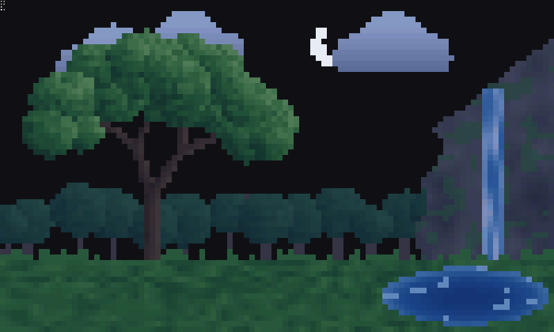
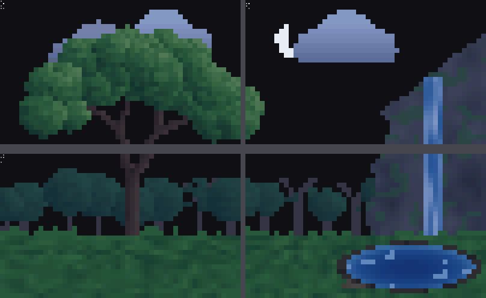
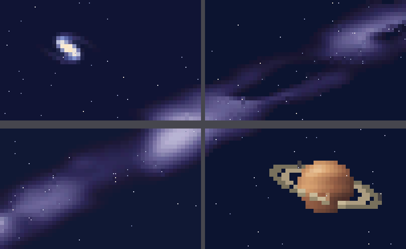

# tidetop

A tidepic scene in your terminal. [한국어](README.ko.md)

tidetop shows how much room your computer has left as a scene, not as numbers. Leave it in a corner of a terminal and read it at a glance: roomy or tight.

| One computer | Four windows joined |
|---|---|
|  |  |

## Install

tidetop is one binary with no dependencies.

**Try it once** (Node.js 16+):

```bash
npx tidetop
```

**macOS**

```bash
brew install tidepark/tap/tidetop
```

**Linux**

```bash
# any distribution, with curl or wget (installs to /usr/local/bin, or ~/.local/bin)
curl -fsSL https://raw.githubusercontent.com/tidepark/tidetop/main/install.sh | sh
wget -qO- https://raw.githubusercontent.com/tidepark/tidetop/main/install.sh | sh

# Debian, Ubuntu
curl -fsSLO https://github.com/tidepark/tidetop/releases/latest/download/tidetop_linux_amd64.deb && sudo apt install ./tidetop_linux_amd64.deb

# Fedora, RHEL, Rocky, Alma
sudo dnf install https://github.com/tidepark/tidetop/releases/latest/download/tidetop_linux_amd64.rpm

# Alpine
wget https://github.com/tidepark/tidetop/releases/latest/download/tidetop_linux_amd64.apk && sudo apk add --allow-untrusted ./tidetop_linux_amd64.apk
```

On ARM (for example a Raspberry Pi or a Graviton server), use `arm64` instead of `amd64`. `npm install -g tidetop` works too.

**Windows**: `npm install -g tidetop`, or the zip from [Releases](https://github.com/tidepark/tidetop/releases).

**Go**: `go install github.com/tidepark/tidetop@latest`

The npm package is a thin wrapper: it carries the same release binaries as small per-platform packages and starts the one for your system. Its code is in [`npm/`](npm). When started through npm, Node stays running beside tidetop (about 30 MB); install the binary directly to avoid that.

## Use

```bash
tidetop                    # the grove, reading this computer's CPU
tidetop --scene stars      # another scene (or press Tab while it runs)
tidetop --demo             # a pretend value that rises and falls every 40 seconds
```

Press `h` for keys and `q` to quit. `tidetop --help` lists every option; `man tidetop` has more when installed with Homebrew, the install script, or a .deb/.rpm/.apk package.

## Scenes

The grove and the night sky read **headroom**: 100 minus CPU use. They grow fuller when the computer has room and sparser when it is busy, so they draw less when the computer is busy. When headroom falls below 10%, thin lines flicker across the scene like a faulty monitor.

| Scene | Reads | Roomy | Tight |
|---|---|---|---|
| `grove` (default) | headroom | leaves, green ground, a full pond, a waterfall | bare branches, dry ground |
| `stars` | headroom | a clear sky, the Milky Way, twinkling stars, meteors | clouds over a dark sky |
| `campfire` | CPU use | embers | a large fire |
| `tide` | memory and CPU | low, calm water | high, rough water |
| `windows` | each CPU core | dark windows | bright windows |

| stars | stars, four windows joined |
|---|---|
|  |  |

Skins: `grove` has `night` (default) and `day`; `stars` has `milkyway` (default) and `galaxy`. Press `z` to switch.

## Keys

| Key | |
|---|---|
| `Tab`, `n` | next scene |
| `z` | next skin |
| `p` / `m` | read CPU / memory |
| `1`, `c` | one piece per CPU core |
| `i` | status line, e.g. `[CPU 12% \| grove]` |
| `s` | read interval: 0.5, 1, 2, 5 s |
| space | read now |
| `t` | switch to `top` (does not come back; not on Windows) |
| `h`, `?` | help |
| `q` | quit |

Keys are not case-sensitive.

## More

- **Switch to top on its own**: `tidetop -t -m 25 -d 3` replaces itself with `top` when headroom stays at or below 25% for 3 seconds.
- **Join several computers' windows**: run `tidetop --grid 2x2 --pos 1` on the top-left computer, `--pos 2` on the top-right, and so on. Each draws its piece of one picture with its own load; the windows do not talk to each other. Only a busy computer's piece dries out.
- **Your own text pictures**: `tidetop init my-art` writes sample files `0.txt` to `100.txt`; `tidetop --art my-art` shows the one whose number the value has reached.
- **Read a feed**: `tidetop --data feed.json` or `--data https://…` reads a [tidepic](https://github.com/tidepark/tidepic) feed instead of this computer.

## Load

tidetop writes only the cells that change and slows its checks when the screen is still. Measured at 120×40 cells, 15 frames a second, on an M-series Mac: about 0.3–3% of one core and 13–16 MB of memory, depending on the scene and value (started directly, not through npm). Lower `--fps` or use `--quality low` to use less.

Over SSH the picture crosses the network, so tidetop draws 8 frames a second instead of 15 and skips cells whose colour moved only slightly. When writing a frame takes long, it waits that much longer, so `q` is not held up behind queued output. `--quality low` sends the least: about 1–2 KB a second.

## Terminals

The full picture needs 24-bit colour and UTF-8. Otherwise tidetop draws with ASCII (`--quality low`). Some terminals that draw in a web view can show stray coloured cells where neighbouring cells differ in colour; use another terminal or `--quality low` there.

## About

tidetop follows [tidepic](https://github.com/tidepark/tidepic), the rule [Tidepark](https://tidepark.com) uses to show numbers as scenes. Contact: hello@tidepark.com

MIT License.
